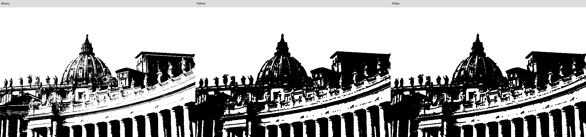
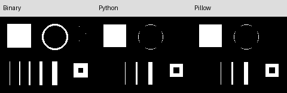

# Лабораторная работа № 1. Эрозия изображения

Вариант 7: эрозия со структурным элементом 3×3.

Цель работы — реализовать алгоритм обработки изображений вручную и средствами библиотеки, сравнить результаты и быстродействие.

## 1. Теоретическая база

Эрозия — операция математической морфологии, уменьшающая области переднего плана. В работе белый цвет (255) обозначает объект, чёрный (0) — фон. Перед эрозией изображение переводится в оттенки серого и бинаризуется: яркость не меньше порога T становится 255, остальные значения — 0. По умолчанию T = 128.

Структурный элемент — заполненный квадрат с центром в обрабатываемом пикселе:

```text
1 1 1
1 1 1
1 1 1
```

Значение результата равно минимуму в окрестности 3×3:

```text
E(x, y) = min B(x + dx, y + dy),  dx, dy ∈ {-1, 0, 1}.
```

Пиксель остаётся белым, только если все пиксели окрестности белые. Поэтому белые области уменьшаются, одиночные белые точки и тонкие линии исчезают, а чёрные отверстия расширяются.

За пределами изображения принято значение 255 — нейтральное для минимума. Отсутствующие соседи не уменьшают результат, поэтому полностью белое изображение остаётся белым и на границах.

## 2. Описание разработанной системы

Программа написана на Python с использованием Pillow. Все функции находятся в `main.py`.

Последовательность обработки:

1. Загрузка файла, учёт EXIF-ориентации и перевод в оттенки серого.
2. Пороговая бинаризация средствами Pillow.
3. Ручная эрозия в `erode_python`: обход всех пикселей и поиск минимума по соседям циклами Python.
4. Библиотечная эрозия в `erode_pillow`: добавление белой рамки, применение `ImageFilter.MinFilter(3)` и обрезка рамки.
5. Побайтное сравнение результатов, вывод времени и сохранение изображений.

Результат записывается в отдельное изображение, чтобы изменённые пиксели не влияли на дальнейшие вычисления. При фиксированном ядре сложность прямого алгоритма по времени — O(W·H), по дополнительной памяти — O(W·H).

Для запуска нужны Python 3.9 или новее и Pillow:

```bash
python3 -m venv .venv
source .venv/bin/activate
python -m pip install Pillow==11.3.0
python main.py image.jpeg
```

Порог, число замеров и папка результатов задаются аргументами:

```bash
python main.py image.jpeg --threshold 128 --repeats 5 --output results/photo
python main.py test.png --threshold 128 --repeats 5 --output results/test
```

В выходной папке сохраняются серое изображение (`gray.png`), бинарная маска (`binary.png`), результаты обеих реализаций (`python.png`, `pillow.png`) и общая панель (`comparison.png`).

## 3. Результаты работы и тестирования

Тестирование выполнено на фотографии `image.jpeg` размером 735×491 и бинарном изображении `test.png` размером 160×128. В обоих случаях использован порог 128 и одна итерация эрозии.

### Фотография

Слева — бинарное изображение, в центре — результат Python, справа — Pillow.



После эрозии светлые детали здания стали тоньше, небольшие белые участки исчезли. Тёмные области расширились, поскольку передним планом в алгоритме считается белый цвет.

### Тонкие линии и геометрические фигуры



Одиночные точки и вертикальные линии толщиной один и два пикселя исчезли. Более толстые линии стали тоньше, квадрат уменьшился, отверстие внутри правой фигуры расширилось. Тонкое кольцо распалось на отдельные участки.

| Изображение | Белых пикселей до | После эрозии | Различий между реализациями |
|---|---:|---:|---:|
| `image.jpeg` | 254417 | 220353 | 0 |
| `test.png` | 3295 | 2302 | 0 |

Результаты обеих реализаций совпали побайтно на обоих изображениях.

### Быстродействие

Измерения выполнены на macOS, arm64, Python 3.9.6, Pillow 11.3.0. Перед измерением каждая функция вызывается один раз для прогрева. В таблице приведена медиана пяти запусков, измеренных через `perf_counter()`.

| Изображение | Размер | Python, мс | Pillow, мс | Ускорение |
|---|---|---:|---:|---:|
| `image.jpeg` | 735×491 | 566.948 | 9.031 | 62.78× |
| `test.png` | 160×128 | 32.216 | 0.520 | 62.00× |

Измеряется полный вызов функции эрозии, включая создание результата, а у Pillow также добавление и обрезку рамки. Загрузка, бинаризация, сравнение и сохранение в замер не входят. Каждый повтор обрабатывает одну и ту же исходную маску.

Ускорение рассчитано как отношение времени Python к времени Pillow. Библиотечная реализация быстрее за счёт выполнения основной обработки в скомпилированном коде. Точные значения времени зависят от нагрузки компьютера.

## 4. Выводы

Эрозия с ядром 3×3 реализована вручную и через Pillow. При одинаковой обработке границ обе реализации дали идентичные результаты. Операция уменьшает белые области и удаляет мелкие детали, но может уничтожать полезные тонкие элементы. На двух тестовых изображениях Pillow оказался примерно в 62–63 раза быстрее ручной реализации.

## 5. Использованные источники

- Методическое задание к лабораторной работе № 1, вариант 7.
- [OpenCV: Morphological Transformations](https://docs.opencv.org/4.13.0/d9/d61/tutorial_py_morphological_ops.html).
- [Pillow: ImageFilter.MinFilter](https://pillow.readthedocs.io/en/stable/reference/ImageFilter.html#PIL.ImageFilter.MinFilter).
- [Python: time.perf_counter](https://docs.python.org/3/library/time.html#time.perf_counter).
